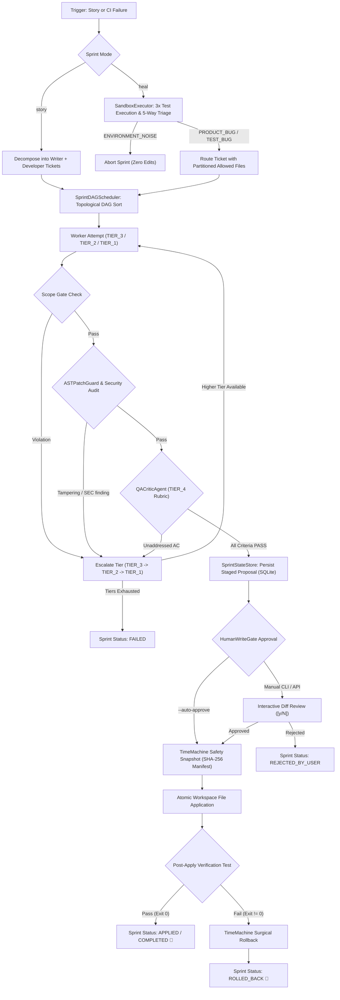

# 🤖 Hermes Multi-Agent Orchestrator

[]()
[]()
[]()
[]()
[](LICENSE)

**Hermes Multi-Agent Orchestrator** is an enterprise-grade autonomous software engineering and self-healing system built on a hierarchical multi-model architecture. It coordinates 8 specialized agent roles across 4 competence tiers with deterministic Scope Gates, an AST Test-Tampering Guard, automated multi-tier escalation, a durable SQLite state store, and a safety-first Human Write-Gate backed by a SHA-256 TimeMachine snapshot engine.

---

## 🏗️ The 8-Agent Hierarchy & Allowed Scopes

Every agent role is governed by a strict system prompt, explicit ModelTier, assigned tools, and inviolable scope boundaries enforced at the Python layer:

| Agent Role | Model Tier | Calls LLM | Allowed Scope | Key Responsibilities & Invariants |
| :--- | :--- | :---: | :--- | :--- |
| **ScrumMasterOrchestrator** | `TIER_1_TECH_LEAD` | Yes | Global governance | Owns sprint planning (`create_sprint_plan`), topological DAG scheduling, ticket routing, escalation governance, and write-gate lifecycle. Never bypasses security or QA gates. |
| **RequirementsAgent** | `TIER_2_SENIOR_SWE` | Yes | Read-only workspace | Slices user stories and stack traces into deterministic Acceptance Criteria (`AC-1..N`), Edge Cases (`EC-1..N`), and context slices using AST analysis. Read-only; never edits files. |
| **DeveloperAgent** | `TIER_3_JUNIOR_SWE` | Yes | Implementation files only (`src/`, `lib/`, etc.) | Implements features and resolves product defects. **Forbidden from modifying test files (`tests/*`)** to make failing code pass. |
| **TestCaseWriterAgent** | `TIER_3_JUNIOR_SWE` | Yes | Test files only (`tests/*`) | Proactively authors unit, integration, and Playwright tests from acceptance criteria. **Forbidden from eroding assertions or skipping tests.** |
| **TestHealerAgent** | `TIER_3_JUNIOR_SWE` | Yes | Test files only (`tests/*`) | Surgically repairs selectors, mocks, and fixtures for confirmed `TEST_BUG` or `FLAKY_TEST` tickets. **Forbidden from editing implementation code or weakening assertions.** |
| **AutomationTesterAgent** | `TIER_3_JUNIOR_SWE` | **No** (Python) | Ephemeral Git Worktree | Executes test suites 3x (`repeat=3`) in isolated worktrees, collects JUnit XML/traces, classifies failures, and triggers healer tickets only for confirmed test bugs. |
| **QACriticAgent** | `TIER_4_QA_CRITIC` | **No** (Python) | Read-only proposal review | Evaluates proposals against acceptance criteria rubrics and edge-case error paths. Rejection forces escalation (`TIER_3 -> TIER_2 -> TIER_1`). |
| **SecurityBlastRadiusAgent** | `TIER_4_QA_CRITIC` | **No** (Python) | Read-only AST audit | Audits proposals for constant-time crypto (`hmac.compare_digest`), SQL injection, `shell=True`, and path traversal. Blocks write-gate on critical findings. |

---

## 🌐 Any Model Can Be Any Agent (19 LLM Providers)

Hermes uses standard library `urllib.request` for network LLM requests—**no OpenAI, Anthropic, or Google SDKs are required**. A single unified client (`HermesLLMAdapter.complete`) routes to local engines, cloud providers, or CLI sandboxes across wire protocols:
* `openai_chat`: Standard OpenAI-compatible chat completions (`POST {base}/chat/completions`)
* `gemini`: Google Generative Language REST API (`POST https://generativelanguage.googleapis.com/v1beta/models/{model}:generateContent`)
* `anthropic`: Anthropic Messages REST API (`POST https://api.anthropic.com/v1/messages`)
* `subprocess`: Sandboxed CLI invocation (e.g. `claude_code` with strict timeout, budget caps, and workspace isolation)

### Supported Provider Registry

| Provider | Wire Protocol | Default Base URL | Base URL Env Var | API Key Env Var | Default Model Env Var |
| :--- | :--- | :--- | :--- | :--- | :--- |
| `ollama` | `openai_chat` | `http://127.0.0.1:11434/v1` | `OLLAMA_BASE_URL` | *(None / local)* | `OLLAMA_MODEL` |
| `lmstudio` | `openai_chat` | `http://127.0.0.1:1234/v1` | `LMSTUDIO_BASE_URL` | *(None / local)* | `LOCAL_LLM_MODEL` |
| `llamacpp` | `openai_chat` | `http://127.0.0.1:8080/v1` | `LLAMACPP_BASE_URL` | *(None / local)* | `LOCAL_LLM_MODEL` |
| `vllm` | `openai_chat` | `http://127.0.0.1:8000/v1` | `LOCAL_LLM_BASE_URL` | `LOCAL_LLM_API_KEY` | `LOCAL_LLM_MODEL` |
| `tgi` | `openai_chat` | `http://127.0.0.1:8080/v1` | `LOCAL_LLM_BASE_URL` | `LOCAL_LLM_API_KEY` | `LOCAL_LLM_MODEL` |
| `localai` | `openai_chat` | `http://127.0.0.1:8080/v1` | `LOCALAI_BASE_URL` | `LOCAL_LLM_API_KEY` | `LOCAL_LLM_MODEL` |
| `openai_compatible` | `openai_chat` | `http://127.0.0.1:8000/v1` | `LOCAL_LLM_BASE_URL` | `LOCAL_LLM_API_KEY` | `LOCAL_LLM_MODEL` |
| `openai` | `openai_chat` | `https://api.openai.com/v1` | `OPENAI_BASE_URL` | `OPENAI_API_KEY` | `OPENAI_MODEL` |
| `grok` | `openai_chat` | `https://api.x.ai/v1` | `XAI_BASE_URL` | `XAI_API_KEY` | `XAI_MODEL` |
| `groq` | `openai_chat` | `https://api.groq.com/openai/v1` | `GROQ_BASE_URL` | `GROQ_API_KEY` | `GROQ_MODEL` |
| `openrouter` | `openai_chat` | `https://openrouter.ai/api/v1` | `OPENROUTER_BASE_URL` | `OPENROUTER_API_KEY` | `OPENROUTER_MODEL` |
| `mistral` | `openai_chat` | `https://api.mistral.ai/v1` | `MISTRAL_BASE_URL` | `MISTRAL_API_KEY` | `MISTRAL_MODEL` |
| `deepseek` | `openai_chat` | `https://api.deepseek.com/v1` | `DEEPSEEK_BASE_URL` | `DEEPSEEK_API_KEY` | `DEEPSEEK_MODEL` |
| `together` | `openai_chat` | `https://api.together.xyz/v1` | `TOGETHER_BASE_URL` | `TOGETHER_API_KEY` | `TOGETHER_MODEL` |
| `fireworks` | `openai_chat` | `https://api.fireworks.ai/inference/v1` | `FIREWORKS_BASE_URL` | `FIREWORKS_API_KEY` | `FIREWORKS_MODEL` |
| `azure_openai` | `openai_chat` | `https://{resource}.openai.azure.com` | `AZURE_OPENAI_BASE_URL` | `AZURE_OPENAI_API_KEY` | `AZURE_OPENAI_DEPLOYMENT` |
| `gemini` | `gemini` | `https://generativelanguage.googleapis.com`| `GEMINI_BASE_URL` | `GEMINI_API_KEY` | `GEMINI_MODEL` |
| `anthropic` | `anthropic` | `https://api.anthropic.com` | `ANTHROPIC_BASE_URL` | `ANTHROPIC_API_KEY` | `ANTHROPIC_MODEL` |
| `claude_code` | `subprocess` | `cli` | *(None / binary)* | *(Inherited / CLI auth)* | `CLAUDE_CODE_MODEL` |

> **Offline Fallback**: `LocalHeuristicEngine` runs **only** when `resolve_provider()` returns `"none"` (no API keys and no local server configured). If a provider is configured and returns an HTTP error, the system raises an exception immediately without falling back to heuristics.

### Mixed-Team Configuration Example (`.env`)

Assign different models and providers to individual agents (e.g. Groq for Tech Lead, local Ollama for junior workers, Claude for QA):

```env
# Global Default Provider
HERMES_LLM_PROVIDER=ollama
OLLAMA_BASE_URL=http://127.0.0.1:11434
OLLAMA_MODEL=qwen2.5-coder:7b

# Tier Model Defaults
RERUN_TIER1_MODEL=llama-3.3-70b-versatile
RERUN_TIER2_MODEL=qwen2.5-coder:14b
RERUN_TIER3_MODEL=qwen2.5-coder:7b
RERUN_TIER4_MODEL=claude-3-7-sonnet-20250219

# Per-Agent Overrides (provider:model syntax)
HERMES_AGENT_SCRUM_MASTER_ORCHESTRATOR_MODEL=groq:llama-3.3-70b-versatile
HERMES_AGENT_DEVELOPER_AGENT_MODEL=ollama:qwen2.5-coder:7b
HERMES_AGENT_QA_CRITIC_AGENT_MODEL=anthropic:claude-3-7-sonnet-20250219

# Provider Credentials
GROQ_API_KEY=gsk_your_groq_key
ANTHROPIC_API_KEY=sk-ant-your_claude_key
```

---

## 🚦 Failure Classification & Scope Gate Routing

When a test failure is ingested, `SandboxExecutor.classify_failure` analyzes the multi-run output across 5 deterministic categories:

```text
               pytest execution failure
                          │
          ┌───────────────┴───────────────┐
          ▼                               ▼
Intermittent pass/fail           Deterministic failure
    [FLAKY_TEST]                          │
          │                     Is environment broken?
          │                     (Port, network, bin)
          │                               │
          │                   ┌───────────┴───────────┐
          │                   ▼                       ▼
          │          [ENVIRONMENT_NOISE]     Traceback inspection
          │           (Aborts sprint;                 │
          │            zero file edits)       ┌───────┴───────┐
          │                                   ▼               ▼
          │                            Product frames?   Test frames only?
          │                            (src/, lib/, etc) (tests/ only)
          │                                   │               │
          │                                   ▼               ▼
          │                            [PRODUCT_BUG]     [TEST_BUG]
          │                                   │               │
          │                                   ▼               ▼
          │                            DeveloperAgent   TestHealerAgent
          │                            (impl files only)(test files only)
          ▼                                   │               │
  TestHealerAgent                             └───────┬───────┘
  (test files only)                                   ▼
                                            Scope Gate Verification
                                            (Rejects unauthorized paths)
```

1. **`PRODUCT_BUG`**: Exceptions originating in implementation files (`src/`, `lib/`, `app/`) or `DID NOT RAISE` failures.
   * **Target Agent**: `DeveloperAgent`
   * **Allowed Scope**: Implementation files only. Tests are strictly forbidden from `allowed_files`.
2. **`TEST_BUG`**: Syntax errors in tests, fixture resolution failures, or assertions failing strictly inside `tests/`.
   * **Target Agent**: `TestHealerAgent`
   * **Allowed Scope**: Test files only. Implementation files are strictly forbidden from `allowed_files`.
3. **`FLAKY_TEST`**: Intermittent pass/fail across 3 sandbox executions.
   * **Target Agent**: `TestHealerAgent` (timing, locator drift, race condition repair).
4. **`ENVIRONMENT_NOISE`**: Network timeouts, port collisions (`EADDRINUSE`), or missing system binaries.
   * **Action**: Aborts the sprint immediately. Prevents hallucinated code changes.

---

## 🛡️ Zero Assertion Erosion

`ASTPatchGuard` enforces zero assertion erosion across all test modifications:
* **Forbidden**: Replacing assertions with `assert True`, `assert 1`, `1 == 1`, or `assert True is not False`.
* **Forbidden**: Deleting existing test functions (`def test_*`).
* **Forbidden**: Decreasing the count of assertions in any test file.
* **Forbidden**: Injecting `@pytest.mark.skip`, `@pytest.mark.xfail`, `test.skip`, `test.fixme`, or `test.only`.

---

## 🔄 The Single Unified Pipeline

All interfaces—`hermes_cli.py`, `scripts/run_live_demo.py`, and `server.py`—route through a single unified pipeline in `ScrumMasterOrchestrator.run_sprint`:



---

## 💻 CLI Commands

The unified Hermes CLI provides full control over the multi-agent pipeline:

```powershell
# 1. Inspect the 8-Agent Registry, ModelTiers, and boundaries
python hermes_cli.py agents

# 2. Inspect the 18 LLM Providers and active configuration
python hermes_cli.py providers

# 3. Execute a Feature Story sprint (proactive test authoring + implementation)
python hermes_cli.py run --story "Implement JWT authentication in auth.py" --scope "auth.py" "tests/test_auth.py" --auto-approve

# 4. Execute an Autonomous Self-Healing sprint
python hermes_cli.py heal --target-test "tests/test_ledger.py" --auto-approve

# 5. Programmatically approve a staged sprint proposal
python hermes_cli.py approve <sprint-id>

# 6. Surgically rollback workspace to any TimeMachine snapshot
python hermes_cli.py rollback <snapshot-id>
```

---

## 🌐 FastAPI Server Endpoints

The FastAPI server (`python server.py`) exposes unified endpoints backed by SQLite persistence (`SprintStateStore`):

* `POST /api/sprint/run`: Run unified sprint pipeline (`mode="story"` or `mode="heal"`).
* `GET /api/sprint/{id}`: Load sprint state, ticket DAG, and attempt history from SQLite.
* `POST /api/sprint/{id}/approve`: Approve staged proposal, verify via test runner, and commit or rollback.
* `GET /api/time-machine/snapshots`: List non-destructive snapshots in the integrity ledger.
* `POST /api/time-machine/restore/{id}`: Restore workspace to any snapshot.
* `GET /api/time-machine/snapshots/{id}/diff`: Git-free snapshot diffing via Python `difflib`.

---

## 🧪 Verification & Comprehensive Test Suite

Hermes is verified by 84 automated unit/platform tests and 6 Playwright E2E product tests:

```powershell
# 1. Run the full unit and contract test suite (84 tests)
python -m pytest tests/ -v

# 2. Run the Playwright Tester Console product E2E test suite (6 specs)
python -m pytest console_tests/ -v

# 3. Run the live self-healing smoke demo (6 phases end-to-end)
python scripts/run_live_demo.py

# 4. Verify Python 3.10 standard library syntax compliance across all files
python scripts/syntax_guard.py
```
